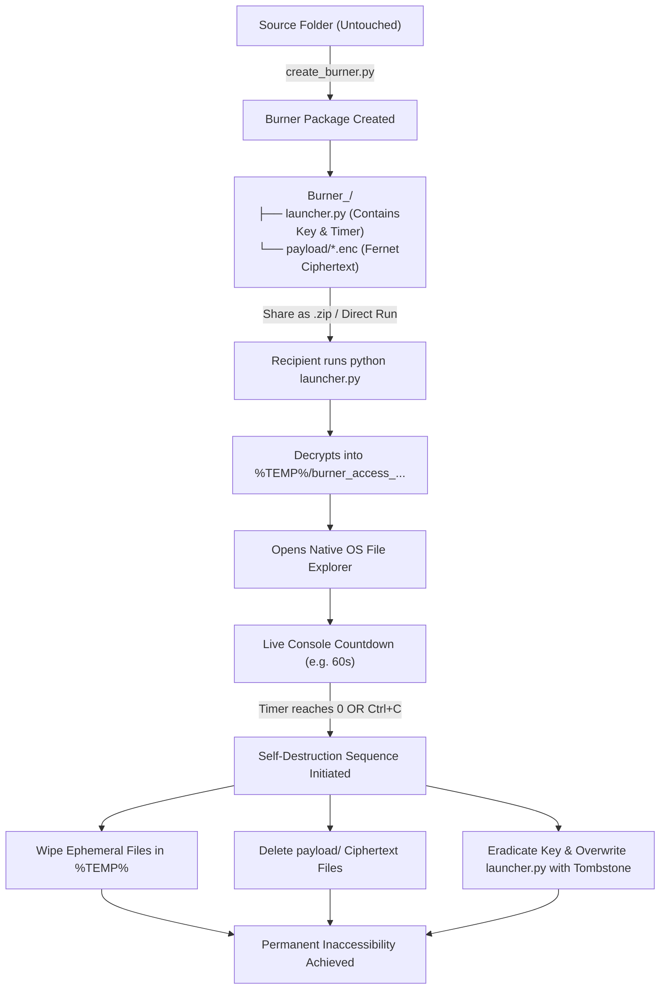

# Burner Folder 📁🔥

> **Local Ephemeral File Sharing Prototype (Project BurntWood)**  
> Prove whether a folder of files can become permanently inaccessible after a time-based countdown, running entirely locally with zero server infrastructure.

[](https://www.python.org/)
[-orange)](#cryptographic-design)
[](#cross-platform-support)
[](#operational-lifecycle)

---

## Table of Contents

- [Overview](#overview)
- [⚠️ Research Experiment & Limitations](#️-research-experiment--limitations)
- [Key Features](#key-features)
- [How It Works (Lifecycle)](#how-it-works-lifecycle)
- [Project Structure](#project-structure)
- [Prerequisites & Installation](#prerequisites--installation)
- [Quick Start Guide](#quick-start-guide)
  - [1. Creating a Burner Folder](#1-creating-a-burner-folder)
  - [2. Launching and Viewing Files](#2-launching-and-viewing-files)
- [Command-Line Options](#command-line-options)
- [How to Share & Distribute (.zip)](#how-to-share--distribute-zip)
- [Self-Destruction Mechanics](#self-destruction-mechanics)
- [Cryptographic & Security Design](#cryptographic--security-design)
- [Troubleshooting & FAQ](#troubleshooting--faq)

---

## Overview

Traditional file encryption tools require recipients to store and manage private keys, while cloud "burn-after-reading" services rely on centralized remote servers to hold and wipe files.

**Burner Folder** explores an alternative local-first design:
- Files are encrypted into authenticated ciphertext packages (`.enc`).
- The launcher decrypts files on-demand into an isolated, ephemeral OS temporary directory and immediately opens the native File Explorer.
- A live console timer counts down the access window.
- Upon timer expiry (or user abort), **the temporary directory is purged**, **the encrypted payload files are deleted**, and **the cryptographic key is permanently erased**.
- The folder itself remains on disk with an immutable expiration notice, preventing Windows process-locking errors while guaranteeing all underlying data is irreversibly destroyed.

---

## ⚠️ Research Experiment & Limitations

> [!WARNING]
> **This software is an experimental proof-of-concept (PoC), not a hardened DRM or military-grade secure deletion tool.**  
> It was developed to explore whether time-bound file access can function **entirely locally without a central server**.

### Fundamental Technical Limitations:

1. **The Local DRM Paradox (Analog Hole & Memory)**:
   - Once a file is decrypted and displayed on screen, the recipient can take screenshots, photograph the screen, or copy/paste content. Preventing a user from copying data displayed on hardware they physically control is fundamentally impossible without proprietary OS-level hardware DRM (e.g. Widevine/FairPlay).

2. **Plaintext Key Accessibility**:
   - In this prototype, `launcher.py` contains the Fernet key in plain text to maintain transparency, readability, and zero obfuscation. A technically proficient recipient can open `launcher.py` in a text editor *before* running it, copy the key, and decrypt the files manually without starting the countdown.

3. **Copy-on-View During the Active Window**:
   - While the temporary folder is open in File Explorer during the countdown, a recipient can copy or drag-and-drop the files to another location on their drive before the timer reaches zero.

4. **Forensic Recovery vs. Standard File Deletion**:
   - The cleanup routines utilize standard operating system deletion calls (`shutil.rmtree` / `unlink`). On unencrypted drives (especially older HDDs), forensic data recovery software could potentially recover file fragments from unallocated space. It does not perform multi-pass cryptographic data wiping (e.g., DoD 5220.22-M).

5. **Abrupt Process Termination / Power Loss**:
   - While `Ctrl+C` triggers an immediate self-destruction sequence, an unhandled kill signal (such as `kill -9` or Windows Task Manager "End Process Tree") or sudden power failure terminates Python before the `finally:` block executes, potentially leaving decrypted files in `%TEMP%`.

### What This Experiment Actually Achieves:
- **Zero-Server Ephemeral Sharing**: Proves a zero-infrastructure workflow for sharing sensitive packages that automatically clean up after themselves.
- **Protection Against Forgotten / Leaked Files**: Prevents sensitive files from lingering forgotten on a recipient's desktop or downloads folder indefinitely.
- **Cold-Storage Security**: Files in transit and sitting on disk remain strong AES-128-CBC ciphertext until explicitly launched.

---

## Key Features

- ⏱️ **Configurable Ephemeral Window**: Set any access timer (e.g., 30s, 60s, 300s) with a live, in-terminal countdown.
- 🧹 **Two-Tier Self-Destruction**:
  - Ephemeral decrypted files wiped from `%TEMP%` / `/tmp`.
  - Encrypted payload files wiped from disk, key permanently wiped from `launcher.py`.
- 📁 **Folder Preservation Architecture**: Does not delete the root directory itself, preventing OS file-locking crashes (`WinError 32`), terminal displacement, and confusing folder disappearance.
- 🪦 **Informative Tombstone State**: Re-running `launcher.py` after expiration displays a clean, readable message confirming that the data was permanently destroyed.
- 🖥️ **Cross-Platform OS Integration**: Automatically opens Windows File Explorer, macOS Finder, or Linux file managers (`xdg-open`).
- ⚡ **Zero Infrastructure**: Operates 100% locally with standard Python. No Docker, no databases, no cloud APIs, and no administrator privileges required.

---

## How It Works (Lifecycle)



---

## Project Structure

```text
Project BurntWood/
├── create_burner.py        # Interactive CLI wizard & packaging script
├── launcher_template.py    # Production-tested template for generated launchers
├── Burner/                 # Baseline prototype implementation
│   ├── launcher.py         # Baseline manual launcher
│   ├── encrypt_setup.py    # One-time manual key generator & encryptor
│   └── payload/            # Encrypted test files (.enc)
├── test_source_files/      # Sample source files for testing
│   ├── credentials.json
│   ├── mission.csv
│   └── secret_notes.txt
└── README.md               # Project documentation
```

---

## Prerequisites & Installation

### Requirements
- **Python**: Version 3.8 or higher.
- **Dependencies**: `cryptography` package.

### Installation

Clone or download this repository, then install the required dependency:

```powershell
pip install cryptography
```

*(On macOS/Linux, use `pip3 install cryptography`)*

---

## Quick Start Guide

### 1. Creating a Burner Folder

Launch the interactive creation wizard:

```powershell
python create_burner.py
```

The wizard will guide you through four simple prompts:

```text
=================================================================
 BURNER FOLDER CREATION WIZARD
=================================================================
This wizard will package any folder into a self-destructing Burner folder.
Original files will remain untouched.

Enter path to source folder to burn: test_source_files
-> Found 3 file(s) in source directory.

Enter destination path for Burner folder [default: Burner_test_source_files]: [Press Enter]
Enter countdown timer in seconds [default: 60]: 30
Permanently burn payload files & key after viewing? (y/n) [default: y]: [Press Enter]

=================================================================
 CREATING BURNER FOLDER PACKAGE
=================================================================
Source Folder     : ...\test_source_files
Destination Folder: ...\Burner_test_source_files
Countdown Window  : 30 seconds
Self-Destruct Mode: PERMANENT BURN (Wipes files & keys, leaves folder)
=================================================================

[1/3] Encrypting 3 file(s) into payload/...
  [OK] Encrypted: credentials.json -> payload/credentials.json.enc
  [OK] Encrypted: mission.csv -> payload/mission.csv.enc
  [OK] Encrypted: secret_notes.txt -> payload/secret_notes.txt.enc

[2/3] Generating launcher.py configured with key and timer...
  [OK] Created: launcher.py

[3/3] Finalizing...
#################################################################
 [SUCCESS] BURNER FOLDER CREATED SUCCESSFULLY!
#################################################################
```

> **Note:** Your original source files in `test_source_files` remain completely untouched and unaltered.

---

### 2. Launching and Viewing Files

Navigate to the generated Burner folder and run the launcher:

```powershell
cd Burner_test_source_files
python launcher.py
```

**What you will see:**
1. A fresh directory is generated in your OS temporary area (e.g. `C:\Users\<user>\AppData\Local\Temp\burner_access_...`).
2. Your native File Explorer will pop up showing the readable, decrypted files.
3. Your terminal displays a live countdown:
   ```text
   ==> Time remaining:  28s [Files active in temp folder]
   ```
4. When the countdown reaches `0` (or if you press `Ctrl+C`):
   - The temporary decrypted files are purged.
   - The `payload/` directory is wiped.
   - The encryption key is overwritten.
   - The cycle completes.

If anyone attempts to run `python launcher.py` a second time:

```text
=================================================================
 BURNER FOLDER - STATUS: EXPIRED & DESTROYED
=================================================================
This Burner Folder has already self-destructed.
All payload files and encryption keys were permanently destroyed.
No data can be recovered.
=================================================================
```

---

## Command-Line Options

For automated workflows, scripts, or advanced users, `create_burner.py` supports CLI flags:

| Flag | Short | Type | Default | Description |
|---|---|---|---|---|
| `--source` | `-s` | `string` | *None* | Path to the folder containing source files to package. |
| `--output` | `-o` | `string` | `./Burner_<name>` | Output directory path for the generated Burner folder. |
| `--timer` | `-t` | `int` | `60` | Number of seconds files remain accessible. |
| `--safe` | | `flag` | `False` | **Safe Mode**: Leaves the encrypted payload intact for repeated testing. |

### Examples

**Standard 45-second Burner folder:**
```powershell
python create_burner.py --source ./test_source_files --output ./Burner_Confidential --timer 45
```

**Safe Mode (keep encrypted payload for repeated testing):**
```powershell
python create_burner.py --source ./test_source_files --output ./Burner_Test --timer 15 --safe
```

---

## How to Share & Distribute (.zip)

To share a Burner folder with a recipient:

### 1. Compress the Folder to `.zip`
- **Windows GUI**: Right-click the generated burner folder (e.g., `Burner_test_source_files`) $\rightarrow$ **Compress to ZIP file**.
- **PowerShell**:
  ```powershell
  Compress-Archive -Path .\Burner_test_source_files -DestinationPath .\Burner_test_source_files.zip
  ```
- **macOS / Linux**:
  ```bash
  zip -r Burner_test_source_files.zip Burner_test_source_files/
  ```

### 2. Instructions for the Recipient
Share the `.zip` along with these instructions:
1. Extract `Burner_test_source_files.zip`.
2. Ensure Python 3 and `cryptography` are installed:
   ```bash
   pip install cryptography
   ```
3. Open a terminal inside the extracted folder and run:
   ```bash
   python launcher.py
   ```

---

## Self-Destruction Mechanics

| Lifecycle State | Ephemeral Files (`%TEMP%`) | Encrypted Payload (`payload/`) | Script (`launcher.py`) | Root Folder |
|---|---|---|---|---|
| **Before Run** | Does not exist | Present (`*.enc` ciphertext) | Contains Key & Timer | Present |
| **During Countdown** | Decrypted & Accessible | Present | Active execution | Present |
| **After Countdown** | **Purged** (`rmtree`) | **Purged** (`rmtree`) | **Key erased; Tombstone written** | **Preserved** |
| **Subsequent Runs** | Does not exist | Does not exist | Prints "Expired & Destroyed" | Preserved |

---

## Cryptographic & Security Design

- **Cipher**: [Fernet](https://cryptography.io/en/latest/fernet/) symmetric encryption built on:
  - **AES-128-CBC** for encryption.
  - **HMAC-SHA256** for message authentication and integrity verification.
  - **PKCS7** padding.
- **Key Storage**: 
  - Each burner package receives an independent, freshly generated 256-bit Fernet key.
  - Keys are held strictly inside the package's `launcher.py` and in memory during execution.
  - The key is permanently overwritten on disk immediately upon timer expiry.
- **Ephemeral Sandbox**:
  - Decrypted files reside only within an isolated temporary directory created via `tempfile.mkdtemp()`.
  - Windows file handles and explorer windows are accounted for before final directory cleanup.
- **Security Boundaries & Threat Model**:
  - *What it guarantees*: Cold storage security (files cannot be opened without running the launcher) and post-expiry inaccessibility (files and keys are wiped from disk).
  - *Out of Scope*: Does not prevent recipients from taking screenshots, copying files out of the temporary folder while the timer is active, or dumping RAM while the process is live.

---

## Troubleshooting & FAQ

#### Q: Getting `SyntaxError: unterminated string literal` on line 138?
This was resolved in the latest release by transitioning to [`launcher_template.py`](file:///c:/Users/kk141/OneDrive/Desktop/Programs/Project%20BurntWood/launcher_template.py). If you encounter this in an older generated folder, simply recreate it using `python create_burner.py`.

#### Q: Getting `ModuleNotFoundError: No module named 'cryptography'`?
Install the required cryptography library:
```powershell
pip install cryptography
```

#### Q: What happens if I close the terminal early with `Ctrl+C`?
The script intercepts `KeyboardInterrupt` and immediately triggers the self-destruction sequence, ensuring no decrypted files are left behind in the OS temporary directory.

#### Q: Why didn't the Burner folder delete itself entirely?
Operating systems (especially Windows) hold open file locks on the currently executing script and the current working directory. Deleting the parent directory while inside it causes OS access errors (`WinError 32`). Leaving the folder preserved with an empty payload and a tombstone notice ensures 100% clean, error-free execution while guaranteeing total data destruction.

---

## License

Prototype released for research and educational purposes under the MIT License.
